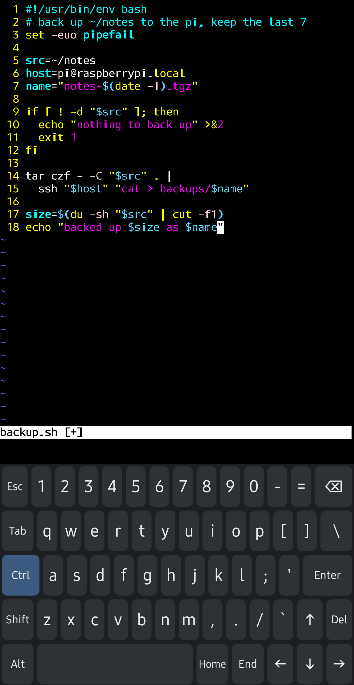

# Bucky Keys

A full PC-layout soft keyboard for Android, built for Termux, SSH clients and coding. Ctrl, Alt, Esc, Tab and the arrows send real key events, so terminals and editors treat it like a physical keyboard.

It is a from-scratch successor to [Hacker's Keyboard](https://github.com/klausw/hackerskeyboard), written in Kotlin on current Android APIs. It is not a fork.

<p align="center">
  
</p>

**Status: early development. There is no release yet.** Join the beta waitlist at [buckykeys.app](https://buckykeys.app) to get one email when testing opens.

## What works today

- Full 5-row PC layout with `~`, `|` and `\` where you expect them
- Ctrl, Alt and Shift as one-shot modifiers that send real `KeyEvent`s: Ctrl+C interrupts a command in Termux, Esc leaves vim's insert mode, and the arrows walk shell history
- Esc, Tab, Home, End, Del and the arrow keys as real keys
- About 13 ms from touch to drawing the key (median, debug build on a Galaxy S23 Ultra, before the screen's own frame); see the [spike report](docs/spike-report.md)

## Planned

- Long-press alternates, key repeat, locked modifiers
- F1–F12
- Layouts from JSON: US, UK, Greek, Dvorak, Colemak, plus your own
- Per-app profiles (for example, Termux and SSH clients get the full layout automatically)
- Settings, themes, split layout for tablets

The full plan, in Greek, is in [PLAN.md](PLAN.md).

## Principles

- **No INTERNET permission.** The keyboard cannot open network connections, so it cannot upload what you type.
- **Open source** under Apache-2.0.
- **Every key, layout and modifier Hacker's Keyboard had stays free.** Optional extras later (layout editor, themes, word prediction) are sold on Google Play to pay for the work. They are in this same repo, and the `foss` build (built from source today, F-Droid planned) unlocks everything for free.

## Building

Requirements: any JDK 17 or newer to start Gradle (it downloads the JDK 21 it runs on, and the JDK 17 toolchain, automatically) and the Android SDK (compile SDK 37, min SDK 26).

```sh
./gradlew assembleFossDebug     # F-Droid flavour, all features unlocked
./gradlew installFossDebug      # install on a connected device
```

Then enable "Bucky" in your phone's keyboard settings and choose it as the current keyboard. Opening the Bucky app walks you through both steps.

Checks run before every commit:

```sh
./gradlew spotlessApply
./gradlew detekt :detekt-rules:test testFossDebugUnitTest testDebugUnitTest :app:architectureTest lintFossDebug assembleFossDebug assemblePlayDebug
```

## Project layout

| Module | Holds |
|---|---|
| `app` | The input method service, `play` and `foss` flavours |
| `ime` | Layout model, key geometry, input engine and the keyboard view (no Compose, no billing) |
| `settings` | Compose settings and onboarding |
| `billing`, `billing-play`, `billing-foss` | Pro entitlement and its two implementations |
| `detekt-rules` | Custom static-analysis rules (build tooling only) |
| `site` | The [buckykeys.app](https://buckykeys.app) landing page |

## Contributing

Ideas, layout requests and bug reports are welcome as [issues](https://github.com/DimiVlachos/bucky/issues/new/choose). For code, see [CONTRIBUTING.md](CONTRIBUTING.md). Commits need a DCO sign-off (`git commit -s`).

## License

[Apache-2.0](LICENSE). See [NOTICE](NOTICE).
