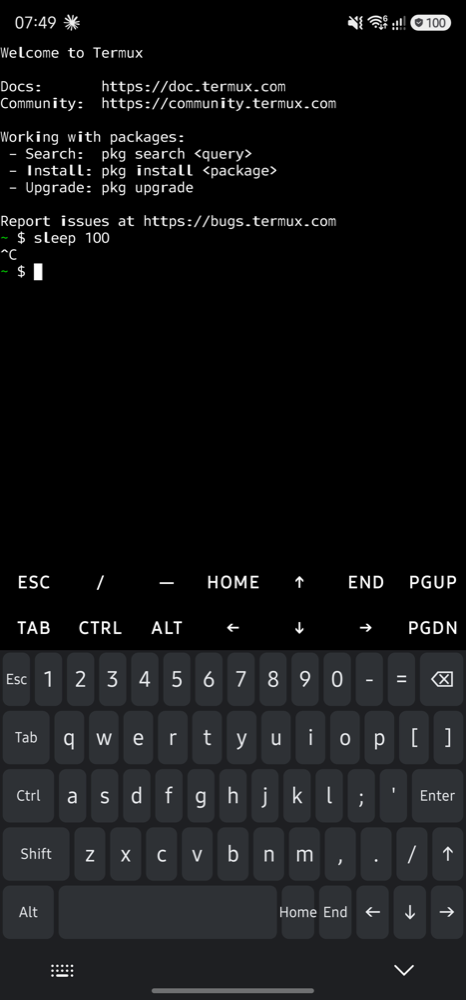
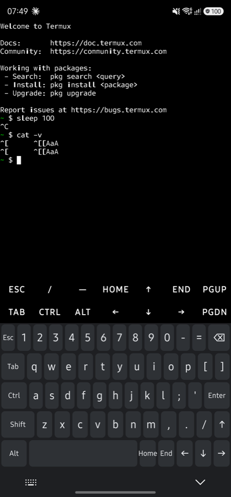
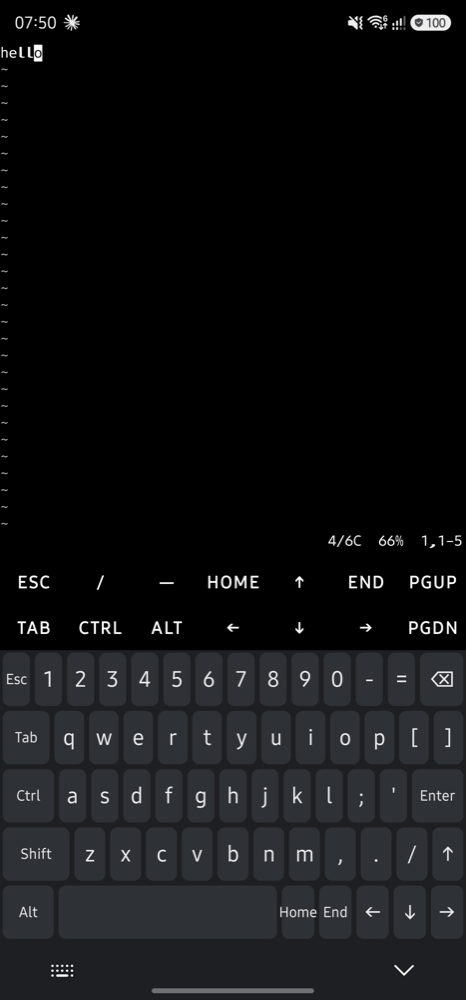
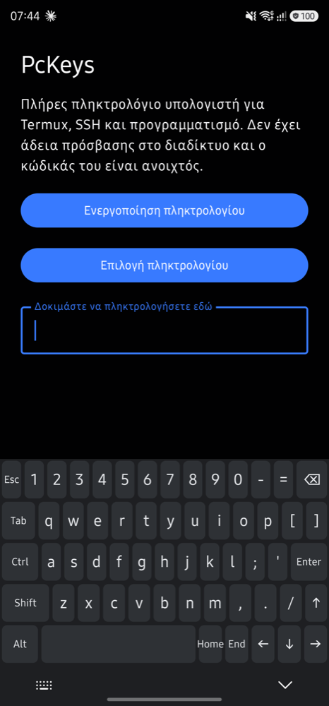

# Week 2 spike report

Date: 18 October 2026. Branch `feat/week-2-spike`.

The question for Gate 0 (PLAN §10): can a Canvas keyboard send real key events that Termux treats as a physical keyboard, Ctrl+C and Esc above all?

## Gate 0, technical half

- [x] Ctrl+C interrupts a running command in Termux.
- [x] Esc reaches Termux as a real escape key, and vi leaves insert mode with it.
- [ ] Waitlist or community signal. This half is decided by Dimitris, not by code.

## Device

Samsung Galaxy S23 Ultra (SM-S918B), Android 16, One UI 8 (build S918BXXSAFZI1), gesture navigation, adaptive refresh rate. Build: `fossDebug`. Termux from F-Droid, fresh install.

## Results

| Check | Input on PcKeys | Result |
|---|---|---|
| Ctrl+C in Termux | `sleep 100`, Enter, Ctrl, c | `^C` and a new prompt |
| Raw keys in Termux | `cat -v`, then Esc, Tab, ↑, a, Shift, a, Enter | `^[`, a tab, `^[[A`, `a`, `A` |
| Ctrl+D in Termux | Ctrl, d | `cat` ends |
| Esc in vi (`/system/bin/vi`) | `vi`, i, `hello`, Esc, `:q!`, Enter | normal mode after Esc, back at the prompt |
| Text field (Compose) | h i Shift a Space 1 ⌫ | `hiA ` |
| Ctrl chord in a text field | Ctrl, a, ⌫ | field emptied |
| Arrows and Backspace | `test`, ←, ←, ⌫ | `tst` |
| Crash buffer | whole session | empty |

vim is not installed in a fresh Termux. vi from Android's toybox needs Esc in exactly the same way, so it stands in here. Taps were injected with `adb shell input tap` at the key centres.

## Latency

Measured from the touch event's `eventTime` to the end of `KeyboardView.onDraw` (debug builds, log tag `PCK-LAT`), over 52 injected taps in Termux:

| min | p50 | p95 | max |
|---|---|---|---|
| 3 ms | 13 ms | 21 ms | 22 ms |

The panel was rendering at 60 Hz (One UI drops the rate when idle, and injected taps do not raise it), so most of each number is waiting for the next vsync. One frame at 60 Hz is 16.7 ms, so p50 lands within the frame after the touch and p95 one frame later. The measurement leaves out RenderThread and compositor time, roughly one more frame. Next step: real-finger samples at 120 Hz, plus `dumpsys gfxinfo` for frame-level detail.

## What the spike found

- **Bottom inset on One UI 8:** with gesture navigation, the system strip that holds the IME switch and hide buttons arrives as a 180 px `tappableElement` inset, while `navigationBars` reports only 56 px. Padding by the navigation-bar inset alone left the bottom row under the system buttons. `KeyboardView` now pads by both.
- **Reinstall resets the keyboard:** reinstalling the APK switches the system default IME back to Samsung Keyboard. During development, run `adb shell ime set dev.pckeys.keyboard/.PcKeysImeService` after every install.
- **Termux extra keys:** Termux shows its own extra-keys row above any IME, and it takes 2 rows of vertical space. The terminal profile in week 8 should document how to turn it off (`extra-keys = []` in `termux.properties`).

## Gaps by design (weeks 3–5)

JSON layouts and parser, Locked modifiers, chording, key repeat, long-press alternates, key preview inside the view, `onComputeInsets`, landscape, release haptics, EditorInfo handling (Enter actions, password, number fields).
